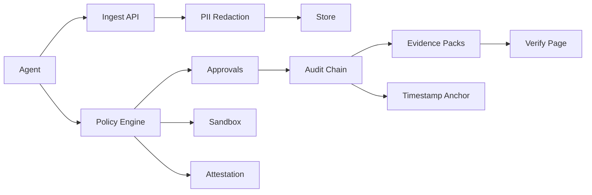

# AgentGuard — AI Workforce Governance Console

Log every agent action, enforce permissions and human approvals, track cost and reliability, and export tamper-evident, audit-ready evidence.

**Current version: 1.4.0** — v1 core + v1.1 enterprise expansion + v1.2 autonomous governance & deep trust + v1.3 ecosystem & growth + v1.4 Material Design 3 redesign.

> Contributing? See [CONTRIBUTING.md](CONTRIBUTING.md) and our [Code of Conduct](CODE_OF_CONDUCT.md).

## What it does

**The golden path (the one thing that must work perfectly):** an agent calls `policy/check` and is allowed, denied, or held for human approval; every action is ingested with PII redacted; every decision lands in a hash-chained audit log; a reviewer can approve or reject; and an auditor can export and independently verify a signed evidence pack.

### v1 — Core
- **Agent registry** — agents, risk tiers, kill switch (pause/quarantine denies immediately), per-agent API keys (`ag_live_…` / `ag_test_…`, hash-only, scoped, rotatable, revocable)
- **Event ingestion** — batched `POST /api/v1/ingest` (≤500 events, idempotency keys), OTLP traces, PII redaction before storage (email, phone, card via Luhn, SSN, API keys/JWT, IBAN), large payloads to R2
- **Policy engine** — one `evaluatePolicy` function, precedence deny > require_approval > rate_limit/spend_cap > allow, versioned rules, simulation, `<150ms p95` target
- **Human approvals** — SLA queue, routing/escalation, mandatory comments, HMAC-signed callbacks, two-person rule for critical tier, self-approval blocked server-side
- **Tamper-evident audit log** — SHA-256 hash chain per org, append-only triggers, checkpoint anchors, verification that names the exact first broken row, evidence packs (PDF + CSV + JSON + Ed25519-signed manifest)
- **Cost & reliability** — spend by agent/workflow/model, budgets/alerts/anomaly detection, trace explorer, editable pricing table
- **Billing** — Paddle Billing (webhooks, idempotent, out-of-order safe, overage metering, dunning UX), plan-limit middleware
- **Add-ons** — content compliance checker, client-proof reporting, support resolution QA
- **SDKs + MCP** — `packages/sdk-ts`, `packages/sdk-python`, `packages/mcp-server` (4 tools: check_policy, request_approval, get_approval_status, log_event)

### v1.1 — Enterprise readiness, intelligence, scale
- **SSO/SAML + SCIM 2.0** — mock-SAML (HMAC, test-only), JIT provisioning, require-SSO enforcement, SCIM Users, deprovision revokes sessions
- **Data residency** — per-org EU/US region, region-pinned buckets/queues, cross-region reads blocked + logged, migration job
- **BYOK encryption** — `KmsProvider` interface, MockKMS (AES-256-GCM, env-gated, rejected in production), AWS/Cloudflare adapters, key rotation + re-encryption
- **Red-team suite** — 5-attack library, scored reports, one-click draft policy from a finding
- **Behavior baselining & drift** — per-agent baselines, z-score drift alerts with offending traces
- **Cost optimizer** — downgrade/cache/batching recommendations with projected savings and quality guardrails
- **SIEM streaming** — generic/Splunk/Datadog, HMAC-signed delivery, exactly-once replay, buffered retry
- **Incident runbooks** — compromised-agent playbook (quarantine → revoke keys → freeze approvals → notify → evidence pack)
- **Policy packs** — EU AI Act, SOC 2, finance DLP, support QA; draft-only install + simulation, separate audited activation
- **Approvals mobile PWA** — Web Push (VAPID), offline decision queue with conflict winner, mobile approve page

### v1.2 — Autonomous governance & deep trust
- **Token-stream inspection (A1)** — streaming LLM output inspected token-by-token against content-guard policies; violations terminate the stream mid-flight, redact the tail, log a `guardrail_triggered` event
- **Sandboxed tool execution (A2)** — `execute_in_sandbox` policy action; LocalSandbox (dev/test) + Docker/Firecracker providers, egress allowlist, CPU/memory/time limits, full stdin/stdout/stderr evidence
- **Agent identity attestation (A3)** — short-lived workload-bound tokens for high/critical tiers; stolen-key replay without attestation is denied + audit-logged; SPIRE-style interface
- **Natural-language policy authoring (A4)** — “blocks prod database writes on weekends” → Zod-validated draft + plain-English explanation + simulation; drafts never auto-activate
- **Policy autopilot (A5)** — nightly proposals from approval decisions + drift findings with evidence counts; two-person approval to loosen deny-class rules; never auto-activates
- **Collusion detection (A6)** — graph analysis for split-bypass patterns (chunked exfiltration, reassembled actions), reconstructed chains naming all agents, opt-in auto-quarantine
- **Public-chain anchoring (A7)** — daily Merkle roots anchored via OpenTimestamps / optional EVM chain; offline pack verification: row → Merkle root → timestamp proof → chain tx
- **Continuous compliance monitoring (A8)** — scheduled control tests (kill-switch, chain, checkpoint backup, redaction probe), 30-day auditor history
- **Private peer benchmarking (A9)** — opt-in anonymized aggregates with differential privacy (epsilon budget 1.0/window), percentile bands, no org identifiable
- **Full lineage tracking (A10)** — model/prompt/tool/policy/SDK versions on every trace, what-changed diffs, lineage block in evidence packs

### v1.3 — Ecosystem & growth
- **Agent marketplace (C1)** — publish agents with trust scores from governance history only (never self-reported); publish threshold 60, verified-governance badge at 80 + verified chain; one-click “govern this agent” onboarding
- **A2A governance (C2)** — per-pair allow/deny/require-approval, content guards on payloads, exact-cent cost attribution across the chain, message audit records linking the full multi-agent trace
- **White-label console (C3)** — per-org logo/colors/custom domain/branded emails, client portal scoped to one org, leak-checked branded output
- **MSP multi-org console (C4)** — cross-org alert rollup, per-client health scores recomputed nightly, delegated admins with scoped permissions, enforced cross-org isolation
- **Client billing (C5)** — per-client usage metering, invoice generation with a real PDF, margin reports reconciling to the penny in integer cents, audit-logged invoices
- **Scheduled governance audits (C6)** — recurring weekly/monthly auto-audits: control tests + findings + signed evidence pack + email/portal delivery with delivery log
- **Warehouse sync (C7)** — events/audit/costs to BigQuery, Snowflake, Postgres via `WarehouseSink`; documented schema; exactly-once backfill with progress
- **On-call integrations (C8)** — PagerDuty/Opsgenie: SLA-breach escalation, decision resolution, round trip audit-logged
- **Public trust badge (C9)** — Ed25519-signed “Governed by AgentGuard” embed, public verification endpoint, tamper fails, revoked orgs invalid
- **Voice agent governance (C10)** — STT behind a provider interface, transcript policy enforcement, barge-in (warn/terminate) on violation, `guardrail_triggered` event with audio segment evidence, PII-redacted transcripts

### v1.4 — Complete UI/UX redesign (Material Design 3)
- **Design system** — M3 color roles (indigo `#4F46E5` seed, true dark theme), elevation, shape, type scale, motion with `prefers-reduced-motion`, state layers, density (comfortable/compact in Settings → Security, persisted in `localStorage`). No new dependencies; primitives hand-built. Dev-only `/design` gallery (404 in production).
- **Global shell** — app bar with Cmd+K search, theme toggle, notification center, org switcher, user menu; nav rail on desktop, bottom nav on mobile, drawer for deep nav; PageHeader + breadcrumbs on every page.
- **Every page redesigned** — all 68 routes: marketing, core dashboards, ops queues, and all flows. Confirm dialogs before destructive calls, skeletons, honest empty states, per-section error boundaries. No API, response-shape, domain-logic, auth, billing, audit, or policy-semantics change.
- **Design QA** — token-pair contrast 11/11 PASS WCAG AA (light + dark); HTTP crawl 68/69 routes 200 + `/design` 404-by-design. Screenshots / axe / Lighthouse UNVERIFIED in the build VM (Playwright browser download blocked) — see `docs/design/PAGE_INVENTORY.md`.

## Quickstart

```bash
pnpm install
pnpm db:migrate
pnpm db:seed
pnpm dev
# docker compose up  # Postgres + Redis for local
```

Health: http://localhost:3000/api/health · Ready: /api/ready · OpenAPI: /api/v1/openapi.json

Copy `.env.example` to `.env` and fill in values. Never commit real secrets. When `DATABASE_URL` is unset, the app runs against an in-memory store (same interfaces) for local dev/tests; see `docs/DECISIONS.md` for the adapter choices.

## Production readiness

See [`docs/PRODUCTION_READINESS.md`](docs/PRODUCTION_READINESS.md) for the go / no-go checklist (P1–P10). Short version: the code is CODE-READY — it fails fast on dangerous configs — but launch still needs your accounts, env vars, infra, a human security review, and legal counsel. Check `/api/ready` on the production host: it must return 200 with `mode: "database"`.

## Verification (real runs, not claims)

```bash
pnpm verify:golden   # 59 checks: 21 v1 + 15 v1.1 + 9 v1.2 + 13 v1.3 + 1 PROD (A9 unit-tested by design — DP randomness)
pnpm test            # 112/112 Vitest (25 v1 core + 12 v1.1 + 28 v1.2 + 16 prod + 24 v1.3 + 7 v1.4 design)
pnpm verify:all      # typecheck + lint + test + build + golden — must be green
pnpm package         # produces agentguard-v1.4.0.zip (excludes node_modules, .next, dist, coverage, .env, zips)
```

Gate table: R1–R48 in `docs/VERIFICATION.md` (R1–R18 v1, R19–R28 v1.1, R29–R38 v1.2, R39–R48 v1.3). Measured numbers in `docs/PERFORMANCE.md`: stream-inspect overhead 0.45 ms/call, sandbox cold start 7 ms (LocalSandbox), autopilot 4 ms / 1000 decisions, collusion FPR 0 on 50 normal traces, marketplace scoring 0.0004 ms/call, warehouse sync ~185k rows/s (in-memory fake sink), voice barge-in mean 0.02 ms (mock STT enforcement only).

## Key API routes

| Method + Path | Purpose |
|---|---|
| `POST /api/v1/ingest` | Batch up to 500 events, idempotent |
| `POST /api/v1/policy/check` | allow / deny / require_approval + reasons |
| `POST /api/v1/policy/simulate` | Replay N events vs a draft policy |
| `POST /api/v1/policies/draft-from-nl` | NL utterance → validated draft + simulation (A4) |
| `POST /api/v1/gateway/stream-inspect` | Token-stream inspection (A1) |
| `POST /api/v1/sandbox/execute` | Sandboxed tool execution (A2) |
| `POST /api/v1/attestation/issue`, `/verify` | Workload attestation (A3) |
| `POST /api/v1/autopilot/run`, `/activate` | Autopilot proposals (A5) |
| `POST /api/v1/collusion/detect` | Collusion detection (A6) |
| `POST /api/v1/anchoring/anchor` | Timestamp anchoring (A7) |
| `POST /api/v1/compliance/run`, `GET /api/v1/compliance/controls` | Control tests (A8) |
| `POST /api/v1/benchmarks/publish` | DP peer benchmarks (A9) |
| `POST /api/v1/lineage/diff` | Lineage diff (A10) |
| `POST /api/v1/marketplace/publish`, `/buy` | Marketplace publish + buyer onboarding (C1) |
| `POST /api/v1/a2a/send` | A2A message governance (C2) |
| `GET/POST /api/v1/brand/[orgId]` | White-label brand (C3) |
| `GET /api/v1/msp/overview`, `/clients` | MSP console (C4) |
| `POST /api/v1/billing/clients/invoice` | Client invoice + margin (C5) |
| `POST /api/v1/audits/schedule`, `/run-due` | Scheduled audits (C6) |
| `POST /api/v1/warehouse/sync`, `/backfill` | Warehouse sync (C7) |
| `POST /api/v1/oncall/incidents`, `/resolve` | On-call escalation (C8) |
| `GET /api/badge/verify` | Public trust-badge verification (C9, no auth) |
| `POST /api/v1/voice/check` | Voice governance + barge-in (C10) |
| `GET /api/v1/openapi.json` | Generated OpenAPI spec |

Full contract: `docs/API.md`. Standard error format everywhere: `{ error: { code, message, details, request_id } }`.

## Architecture



Monorepo: `apps/web` (Next.js 14, App Router, TypeScript strict), `packages/shared` (pure domain logic), `packages/sdk-ts`, `packages/sdk-python`, `packages/mcp-server`, `drizzle/` (schema + seed), `examples/`, `scripts/`, `docs/`, `tests/`. See `docs/ARCHITECTURE.md`.

## Deployment

Vercel + Neon + Upstash + Inngest + Cloudflare R2 + Cloudinary. Set env vars from `.env.example`. See `docs/RUNBOOK.md` and `docs/OPERATOR_HANDBOOK.md`.

Production wiring still required (adapters are env-gated and documented, never faked in production paths):
- **Sandbox infra** — `SANDBOX_PROVIDER=docker|firecracker` + image/config, seccomp/cgroup limits per RUNBOOK. LocalSandbox is dev/test isolation, **not** a security boundary.
- **SPIRE** — install SPIRE server + agent, set `SPIRE_AGENT_ADDRESS` + `SPIRE_TRUST_DOMAIN`.
- **Timestamping** — `OTS_CALENDAR_URL` or `EVM_RPC_URL` + `EVM_ANCHOR_CONTRACT`.
- **SAML IdP** — real IdP issuer/audience, `/sso/idp-initiated?orgId=…`, per-org role mapping (mock SAML is rejected in production).
- **KMS** — `AWS_KMS_KEY_ID` / `CLOUDFLARE_KMS_KEY_ID`; rotate + re-encrypt per RUNBOOK.
- **Billing / email / storage / AI** — Paddle, Resend, R2, Cloudinary, Upstash, Inngest, AI providers, Sentry (see `.env.example`).
- **DP epsilon** — default budget 1.0/window, 0.25/query; do not raise without privacy review.
- **Legal text** — terms, privacy, DPA, subprocessors, cookies pages are `LEGAL TEXT REQUIRED` placeholders; have counsel review before launch.

## Docs

- `docs/API.md`, `docs/SECURITY.md` (STRIDE incl. sandbox escape, attestation theft, collusion, timestamp spoofing, marketplace gaming, A2A spoofing, white-label phishing, badge forgery, voice impersonation), `docs/COMPLIANCE.md`, `docs/DECISIONS.md`, `docs/PERFORMANCE.md`, `docs/RUNBOOK.md`, `docs/VERIFICATION.md` (R1–R48), `docs/KNOWN_ISSUES.md`, `docs/COST_ESTIMATE.md`, `docs/OPERATOR_HANDBOOK.md`, `docs/ARCHITECTURE.md`, `docs/PROGRESS.md`, `docs/WAREHOUSE_SCHEMA.md`
- `CHANGELOG.md` — per-release entries (1.0.0, 1.1.0, 1.2.0, 1.2.1, 1.3.0, 1.4.0)

## Honest limits

- Live Docker/Firecracker execution, live SPIRE, live OpenTimestamps/EVM anchoring, live Paddle/Neon/Cloudinary/R2/Upstash/Inngest/Resend/AI, Playwright crawl, and k6 load tests were not run in the build VM — adapters + `NOT_CONFIGURED` behavior are tested; live-infra verification is listed as manual in `docs/VERIFICATION.md`.
- v1.3 live-service gaps (same pattern): no live BigQuery/Snowflake warehouse, no live PagerDuty/Opsgenie, no live STT provider, no live custom-domain TLS in the VM — adapters + `NOT_CONFIGURED` behavior tested; credentials/TLS are manual deployer steps.
- The GitHub App used for pushes cannot write `.github/workflows/ci.yml` (403, needs workflow scope) — add it via the web UI or a local `git push`.
