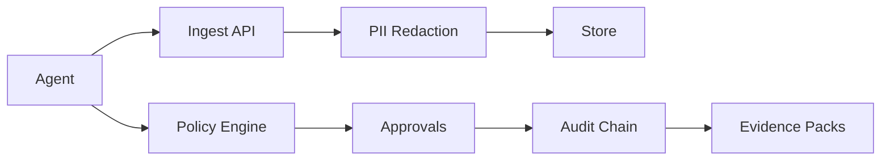

# AgentGuard — AI Workforce Governance Console

Log every agent action, enforce permissions and human approvals, track cost and reliability, export tamper-evident audit-ready evidence.

## Quickstart

```bash
pnpm install
pnpm db:migrate
pnpm db:seed
pnpm dev
# docker compose up  # Postgres + Redis for local
```

Health: http://localhost:3000/api/health · Ready: /api/ready · OpenAPI: /api/v1/openapi.json

## Golden path

```bash
pnpm verify:golden
pnpm verify:all
```

## Architecture



## Deployment

Vercel + Neon + Upstash + Inngest + R2 + Cloudinary. Set env vars from .env.example. See docs/RUNBOOK.md, docs/OPERATOR_HANDBOOK.md.

## Docs

- docs/API.md, docs/SECURITY.md, docs/COMPLIANCE.md, docs/DECISIONS.md, docs/PERFORMANCE.md, docs/RUNBOOK.md, docs/VERIFICATION.md, docs/KNOWN_ISSUES.md, docs/COST_ESTIMATE.md, docs/OPERATOR_HANDBOOK.md, docs/ARCHITECTURE.md
