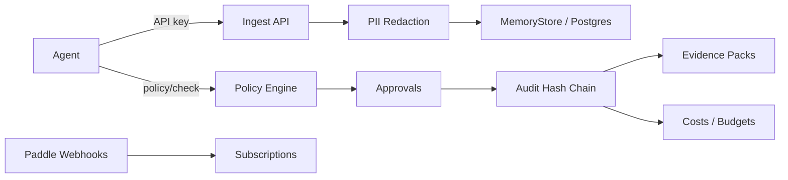

# Architecture

Conventions: business logic in packages/shared (pure, tested). Routes thin: validate (Zod) -> authorize() -> service -> standard error format. Every table carries org_id; authorize() enforces tenant isolation. Failure modes: fail-open/fail-closed per agent; Redis down -> last snapshot; Inngest down -> outbox/dead-letter; R2 down -> dead-letter + clear error.
